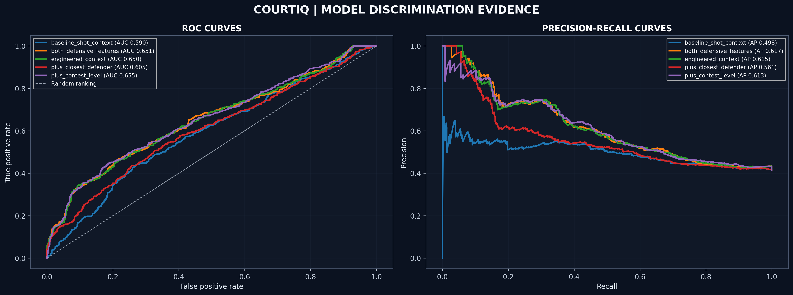
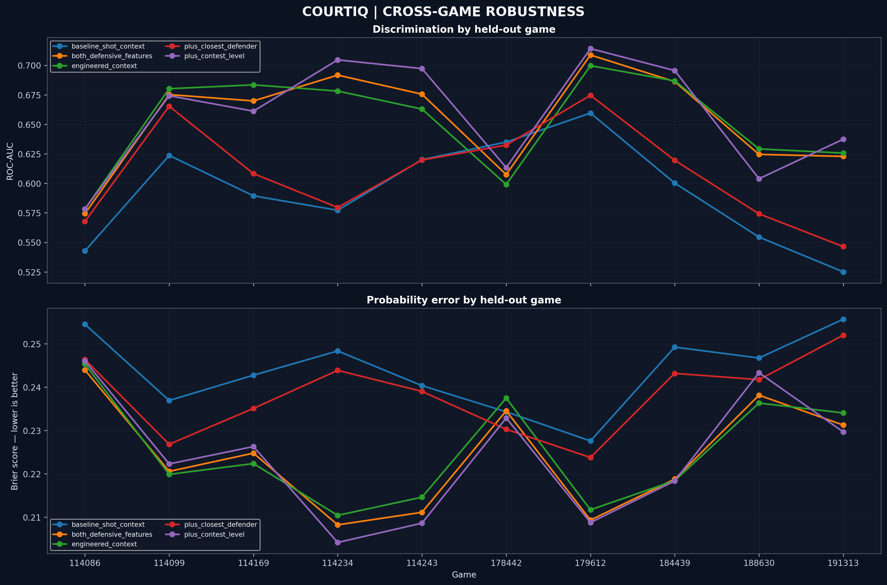
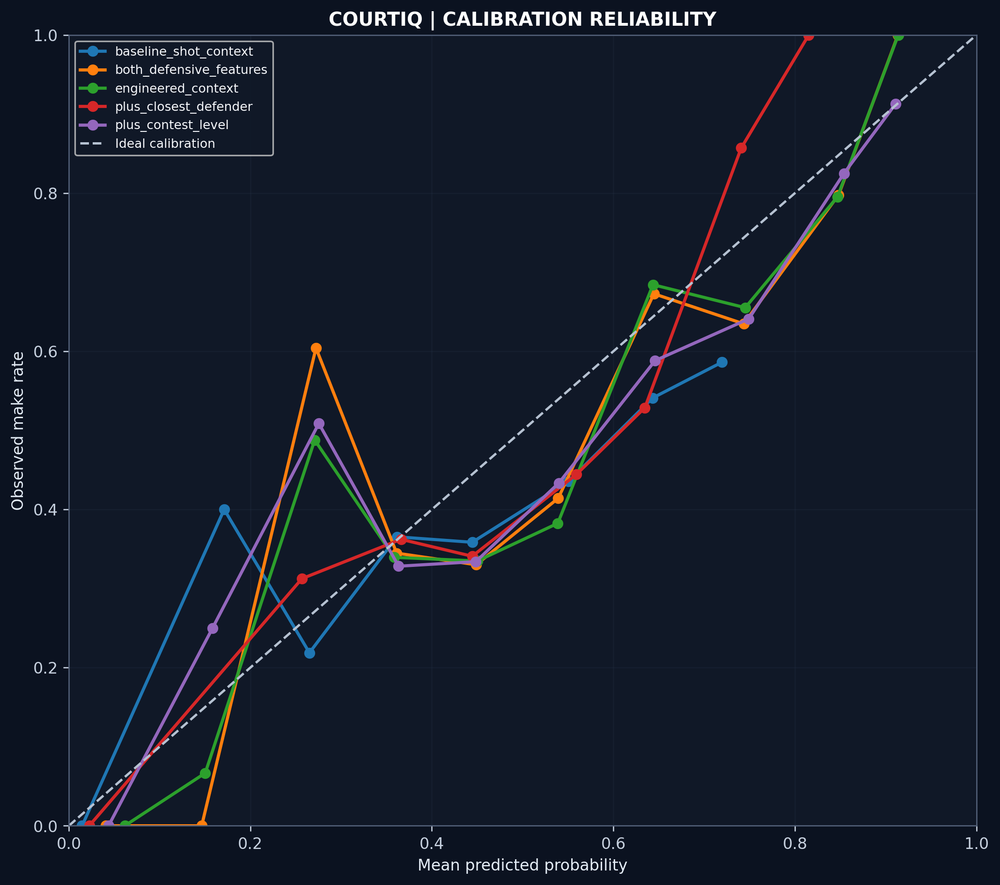

# CourtIQ — The Decision Lab

> **Read the shot. Test the evidence. Respect the uncertainty.**

CourtIQ is an interactive basketball analytics research prototype exploring a practical question: **does adding defensive context improve prediction of whether a shot is made?** It combines model comparisons, out-of-fold (OOF) evaluation, game-level robustness checks, calibration analysis, and an interactive source-coordinate explorer in a judge-friendly, narrated web experience.

[**Launch the live demo →**](https://u19725505-star.github.io/courtiq-decision-lab/) · [Source code](https://github.com/u19725505-star/courtiq-decision-lab) · [Research notebook](https://github.com/u19725505-star/courtiq-decision-lab/blob/main/Notebook/notebook-01-courtiq-the-decision-lab.ipynb)

---

## The question

A shot's outcome depends on more than distance. Defensive pressure and nearby defenders may contain useful information about shot difficulty. CourtIQ tests whether adding those features improves predictive performance beyond a shot-context baseline—and whether the apparent improvement is consistent across games.

**Why it matters:** if validated on broader data, better shot-outcome estimates could help analysts compare shot contexts, evaluate defensive pressure, and frame coaching questions. This prototype is a research aid, **not** a live coaching recommendation system.

## Start here: judge walkthrough

1. Open the [live experience](https://u19725505-star.github.io/courtiq-decision-lab/) and select **Judges Entrance**.
2. Follow the seven chapters: **Research Questions → Data → Spatial Explorer → Model Evidence → Robustness → Limitations → Final Play**.
3. In the spatial explorer, change layers and rotate the view to inspect the source-coordinate display.
4. Compare the models across ROC-AUC, average precision, Brier score, log loss, and accuracy. No single metric tells the whole story.
5. Finish with the robustness and limitations chapters to see what the evidence supports—and what remains unproven.

Narration uses the browser's speech features, which vary by device and browser. All key points are also shown on screen; use **Next/Back** if audio is unavailable. On a small screen, landscape orientation may make the spatial view easier to inspect.

## Key results

The release contains **1,459 shot records across 10 game clusters**, with five saved OOF prediction streams. The reported reproducibility audit confirms complete shot-ID joins and prediction coverage for these saved streams, valid probability ranges, and metric reproduction within 1e-6. See the [reproducibility summary](tables/COURTIQ_FINAL_REPRODUCIBILITY_SUMMARY.json) and [independent metric table](tables/courtiq_cell10_independent_metrics.csv).

| Model | ROC-AUC ↑ | Avg. precision ↑ | Brier score ↓ | Log loss ↓ | Accuracy |
|---|---:|---:|---:|---:|---:|
| Baseline shot context | 0.5902 | 0.4980 | 0.2434 | 0.6795 | 0.5853 |
| Context + closest-defender distance | 0.6045 | 0.5613 | 0.2380 | 0.6673 | 0.5984 |
| **Context + contest level** | **0.6549** | 0.6128 | **0.2237** | 0.6344 | **0.6429** |
| Both defensive features | 0.6510 | **0.6172** | 0.2238 | **0.6334** | 0.6388 |
| Engineered context | 0.6502 | 0.6153 | 0.2249 | 0.6367 | 0.6319 |

*Metric values are rounded from the saved evaluation table. Arrows indicate the preferred direction; accuracy is threshold-dependent and is not a substitute for probability-quality metrics.*

### How to read the result

- **Contest-level context** has the strongest reported ROC-AUC and Brier score in this comparison.
- **Both defensive features** have the highest average precision and slightly lower log loss than the contest-only variant.
- Relative to the baseline, the reported paired game-cluster bootstrap AUC difference is **+0.0648**, with a reported 95% interval of **[0.0383, 0.0874]**. The saved per-game tables show how performance varies across the ten observed games; inspect those rows rather than relying on an aggregate claim of uniform improvement.
- These results are promising within this evaluation, but only **10 game clusters** support the game-level robustness analysis. The interval can be unstable and should not be read as definitive evidence of generalization to new teams, seasons, or competition settings.

### Visual evidence

The repository includes the underlying tables as well as publication-style figures. These are static research outputs; the live demo provides the guided, interactive presentation.

[Browse all figures](figures/) · [Browse all tables and audits](tables/)

## What the prototype includes

- **Seven-step narrated presentation** with judge-focused sequencing and chapter navigation.
- **Model evidence room** comparing discrimination, probability quality, and thresholded accuracy.
- **Interactive spatial explorer** with switchable display layers and rotation.
- **Game-level robustness review** to show whether improvements appear across the observed games.
- **Reproducibility and integrity artifacts** for saved predictions, metric recomputation, coverage, calibration, and per-game analysis.
- **Explicit limitations** so the visual story does not imply more certainty than the analysis supports.

## Data and spatial provenance

The release includes a shot-level engineered dataset and the source extract at [tables/source_shots_raw.csv](tables/source_shots_raw.csv). The current engineered evaluation table has **1,459 records across 10 games**. The spatial explorer's separate [data/court_shots.json](data/court_shots.json) contains **1,433 parseable source-coordinate pairs** across those games; this smaller count reflects coordinate availability, not a different headline model-evaluation sample.

The explorer plots source coordinate values normalized for display. **The source axes, orientation, and court calibration have not been independently verified.** Treat this as a source-coordinate visualization—not a verified regulation-court shot chart. Do not infer exact court zones, player positioning, or coaching prescriptions from its geometry. The displayed height is a visual encoding of shot distance, not a measured ball trajectory.

## Reproducibility and repository map

| Path | Purpose |
|---|---|
| [Research notebook](Notebook/notebook-01-courtiq-the-decision-lab.ipynb) | Research notebook and analysis workflow |
| [Release reproducibility summary](tables/COURTIQ_FINAL_REPRODUCIBILITY_SUMMARY.json) | Release-level validation summary |
| [Independent metrics](tables/courtiq_cell10_independent_metrics.csv) | Independently recomputed metrics used above |
| [Metric reproduction audit](tables/courtiq_cell10_metric_reproducibility.csv) | Metric reproduction audit |
| [Prediction coverage audit](tables/courtiq_cell10_prediction_coverage.csv) | Prediction coverage audit |
| [Game-cluster bootstrap intervals](tables/courtiq_game_cluster_bootstrap_comparison_ci.csv) | Game-cluster bootstrap comparison intervals |
| [Per-game metrics](tables/courtiq_per_game_metrics_v2.csv) | Per-game metric breakdown |
| [Calibration summary](tables/courtiq_cell8_calibration_summary.csv) | Calibration summary |
| [Segment error analysis](tables/courtiq_cell8_segment_error_analysis.csv) | Segment-level error analysis |
| [Source download log](tables/source_download_log.csv) | Source acquisition log |
| [Release manifest](tables/COURTIQ_RELEASE_MANIFEST.csv) | Release artifact manifest |
| [Research figures](figures/) | Saved research figures |
| [Spatial data](data/court_shots.json) | Parsed coordinates used by the web explorer |
| [Web application](index.html) | Standalone interactive web application |

The committed reproducibility summary reports **PASS** for its listed identity/target, shot-ID join, prediction-coverage, probability-range, metric-reproduction, required-artifact, and archive-integrity checks. This validates the saved release artifacts against those checks; it does not independently establish that the model will generalize to new data. The summary references a Kaggle working-directory archive, so the notebook's full end-to-end rerun may still depend on the original data source and execution environment.

The web demo is a static HTML/CSS/JavaScript site and does not require installation to view. To inspect the source locally, clone the repository and open `index.html` in a modern browser. Browser speech support and media autoplay policies vary by device.

## Limitations and next steps

1. **Small number of games:** ten clusters are too few to establish broad generalization; evaluate more games and hold out teams or seasons where possible.
2. **Predictive, not causal:** associations between defensive features and shot outcomes do not prove that changing a defense would cause a particular outcome.
3. **Spatial calibration:** verify the coordinate convention and map source values to a known court before making location-specific claims.
4. **Probability quality:** continue calibration analysis and report uncertainty alongside headline metrics.
5. **Decision utility:** test prospectively whether the information changes analyst or coach decisions and whether those changes help.
6. **Subgroup and shift checks:** assess performance across meaningful shot contexts and on data outside the development sample.

## Competition-readiness checklist

- [x] Public source repository and live prototype links are available.
- [x] README includes a concise project purpose and potential practical application.
- [x] Judge walkthrough explains what to click and in what order.
- [x] Reported model metrics link to saved result artifacts.
- [x] Data provenance, coordinate limitations, and uncertainty are documented.
- [ ] Open the live site on desktop and mobile and manually test every chapter, layer control, and narration control.
- [ ] Confirm the exact current AQX Sports Analytics Data Bowl 4.0 rules, eligibility, deadline, and previous-submission restrictions before submitting. The publicly discoverable AQX 2.0 rules are not a substitute for the 4.0 rules.
- [ ] Complete the competition submission form with the working demo, public repository, concise project description, and actionable impact.

## Responsible-use note

CourtIQ is an exploratory analytics prototype. Its metrics and visualizations should be interpreted in the context of the saved evaluation, small number of games, and unresolved spatial calibration. It is not validated for live coaching, player evaluation, or automated decision-making.

---

*Built as an evidence-first sports analytics research experience: strong presentation, measurable claims, visible uncertainty.*
